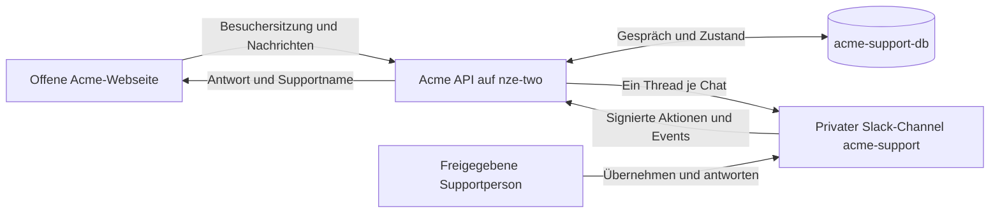

# Slack-Support in Acme

Acme ist eine offene Webseite. Besucher benötigen keinen Login und keinen Microsoft-Tenant. Das Profil `portal.support.json` verwendet `chatSupport.mode: "slack"` mit `auth: "anonymous"`. Das Backend vergibt automatisch eine signierte Besuchersitzung; jeder Besucher kann nur seine eigenen Chats lesen. Supportpersonen übernehmen und beantworten Gespräche im privaten Channel **acme-support** im Workspace **kieks.me GbR**.



## Besuchersitzungen

Sitzungen bleiben 24 Stunden im Browser-Tab erhalten, auch beim Neuladen. Nach Ablauf oder Schließen des Tabs sind alte Chats ohne Token nicht erreichbar. „Chat neu verbinden“ startet eine neue Sitzung. Die Besuchernamen sind pseudonym und nicht verifiziert. Gesprächsaufbewahrung standardmäßig 30 Tage; Slack-Kopien und Backups haben eigene Fristen. Die API begrenzt neue Sitzungen und Nachrichten; Supportrechte werden weiterhin über Slack-Nutzerliste und aktuelle Channel-Mitgliedschaft geprüft.

## Lokale Übernahme-Demo

```sh
pnpm install --frozen-lockfile
pnpm dev:support
```

Das Profil `portal.support-demo.json` verwendet fiktive Personen und Gespräche im Arbeitsspeicher. Lena Demo kann übernehmen, antworten, zurückgeben und abschließen. Es wird keine Slack-Anfrage gesendet. Die lokale Demo bestätigt keine echte Zustellung.

## Runtime und Veröffentlichung

`pnpm setup:slack` erzeugt das öffentliche Profil ohne Zugangsdaten; ein vorhandenes Profil wird nur mit `--force` überschrieben. Der gemeinsame Workflow baut Frontend und API mit `portal.support.json`. Alle CSP-Pakete verwenden dieselbe veröffentlichte Version.

Am API-Host die vorhandenen Provider-Werte beibehalten und `.env.slack.example` ergänzen: `CSP_CONFIG_PATH=portal.support.json`, `CSP_SLACK_ENABLED=true`, `CSP_SLACK_DEMO=false`, `CSP_SLACK_AUTH=anonymous`. Mit `openssl rand -hex 32` einmalig `CSP_CHAT_SESSION_SECRET` erzeugen. Schlüssel, PostgreSQL-Zugang, Bot-Token und Signing Secret ausschließlich als Runtime-Secrets speichern; keine Secrets in Profil, Git oder Frontend.

Die App **Support** ist installiert und dem privaten Channel hinzugefügt. Öffentliche Zuordnung: Workspace `T0C8FU76EBT`, Channel `C0C88MBSZV3`, App `A0C8DSXUQ3C`, berechtigter Supportnutzer André `U0C87P9DU83`. PostgreSQL **acme-support-db** läuft intern auf **nze-two** unter Coolify, ohne öffentlichen Datenbankport, mit 384 MiB Speicherlimit. Azure-Datenbank und Entra-Apps sind nicht erforderlich.

Events `/api/slack/events` sind verifiziert und mit `message.groups` sowie `message.channels` aktiviert; Interaktivität `/api/slack/actions` ist gespeichert. Genau ein API-Replikat pro Support-Datenbank betreiben und Rollouts ohne überlappende Supportprozesse durchführen. Anleitung und Scopes: [CSP-Slack-Dokumentation](https://github.com/kieksme/csp/wiki/slack-support).

## Live-Abnahme

**Live geprüft am 11.10.2026 mit CSP 0.10.1.** Die laufende API verwendet das Image `ghcr.io/kieksme/csp-acme-api:1a29e1bf1c1533f0ab98c4a4ea53da36aca6643f` auf nze-two.

| Prüfung                         | Beobachtetes Ergebnis                                                             |
| ------------------------------- | --------------------------------------------------------------------------------- |
| Offene Webseite                 | Besuchersitzung automatisch, ohne Microsoft-Login                                 |
| Weiterleitung                   | Besucherfrage und fertige KI-Antwort im echten Slack-Thread                       |
| Menschlicher Support            | André übernimmt per Button; seine Thread-Antwort erscheint im Portal              |
| Laufende KI-Antwort             | Übernahme stoppt die Generierung; Verlauf zeigt „Antwort unterbrochen“            |
| Gesprächssteuerung              | Besucherantwort, Rückgabe, erneute Übernahme und Abschluss funktionieren          |
| API-Neustart und Browser-Reload | Gleiche Besuchersitzung, Verlauf und aktive Supportübernahme bleiben erhalten     |
| Separate Besuchersitzung        | Chat fehlt in der Liste; Lesen, Schreiben und SSE liefern 404, ohne Identität 401 |

Der Test-Chat ist abgeschlossen. Der Neustart betrifft nur den einzelnen API-Container; PostgreSQL und VPS wurden nicht neu gestartet. `/health` bestätigt nur den API-Prozess. Synthetische Kontakte und Schichten bleiben synthetisch, auch wenn Slack und KI-Provider live sind.


## Problem gelöst und Klärungsfragen (CSP 0.11.0)

Besucher können ihren eigenen Chat mit **Problem gelöst** beenden, auch während einer KI-Antwort oder Support-Übernahme. Die Lösung wird gespeichert, unterbricht die KI-Ausgabe und aktualisiert Verlauf und Statuskarte in Slack. Berechtigter Support kann im Botmodus ebenfalls lösen; nach Übernahme darf das nur die zuständige Person. **Abschließen** bleibt ohne Behauptung einer Lösung verfügbar.

Bei unklaren Erstfragen wie „Hallo, meine Email“ soll der Assistent zunächst kurz nach dem konkreten Problem fragen. Ticketlinks folgen erst bei erforderlicher Eskalation oder ausdrücklichem Ticketwunsch. Das gemeinsame Headset-Avatar wurde in der vorhandenen Slack-App gespeichert. Die Abnahme der neuen Chat-Funktionen ist bis zum tatsächlichen Rollout separat offen.
