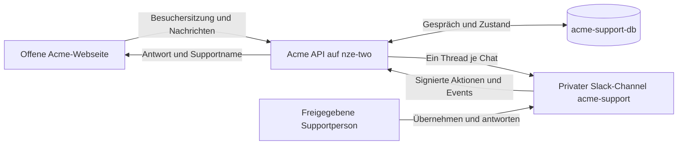

# Slack-Support in Acme

Acme ist eine offene Webseite. Besucher benötigen keinen Login und keinen Microsoft-Tenant. Das Profil `portal.support.json` verwendet `chatSupport.mode: "slack"` mit `auth: "anonymous"`. Das Backend vergibt automatisch eine signierte Besuchersitzung; jeder Besucher kann nur seine eigenen Chats lesen. Supportpersonen übernehmen und beantworten Gespräche im privaten Channel **acme-support** im Workspace **kieks.me GbR**.



## Besuchersitzungen

Sitzungen bleiben 24 Stunden im Browser-Tab erhalten, auch beim Neuladen. Nach Ablauf oder Schließen des Tabs sind alte Chats ohne Token nicht erreichbar. „Chat neu verbinden“ startet eine neue Sitzung. Die Besuchernamen sind pseudonym und nicht verifiziert. Gesprächsaufbewahrung standardmäßig 30 Tage; Slack-Kopien und Backups haben eigene Fristen. Die API begrenzt neue Sitzungen und Nachrichten; Supportrechte werden weiterhin über Slack-Nutzerliste und aktuelle Channel-Mitgliedschaft geprüft.

## Lokale Übernahme-Demo

```sh
pnpm install --frozen-lockfile
pnpm dev:support
```

Das Profil `portal.support-demo.json` verwendet fiktive Personen und Gespräche im Arbeitsspeicher. Lena Demo kann übernehmen, antworten, zurückgeben und abschließen. Es wird keine Slack-Anfrage gesendet. Die lokale Demo bestätigt keine echte Zustellung.

## Runtime und Veröffentlichung

`pnpm setup:slack` erzeugt das öffentliche Profil ohne Zugangsdaten; ein vorhandenes Profil wird nur mit `--force` überschrieben. Der gemeinsame Workflow baut Frontend und API mit `portal.support.json`. Alle CSP-Pakete verwenden dieselbe veröffentlichte Version.

Am API-Host die vorhandenen Provider-Werte beibehalten und `.env.slack.example` ergänzen: `CSP_CONFIG_PATH=portal.support.json`, `CSP_SLACK_ENABLED=true`, `CSP_SLACK_DEMO=false`, `CSP_SLACK_AUTH=anonymous`. Mit `openssl rand -hex 32` einmalig `CSP_CHAT_SESSION_SECRET` erzeugen. Schlüssel, PostgreSQL-Zugang, Bot-Token und Signing Secret ausschließlich als Runtime-Secrets speichern; keine Secrets in Profil, Git oder Frontend.

Die App **Support** ist installiert und dem privaten Channel hinzugefügt. Öffentliche Zuordnung: Workspace `T0C8FU76EBT`, Channel `C0C88MBSZV3`, App `A0C8DSXUQ3C`, berechtigter Supportnutzer André `U0C87P9DU83`. PostgreSQL **acme-support-db** läuft intern auf **nze-two** unter Coolify, ohne öffentlichen Datenbankport, mit 384 MiB Speicherlimit. Azure-Datenbank und Entra-Apps sind nicht erforderlich.

Nach dem API-Start Events `/api/slack/events` und Interaktivität `/api/slack/actions` im Slack-App-Portal konfigurieren. Genau ein API-Replikat pro Support-Datenbank betreiben und Rollouts ohne überlappende Supportprozesse durchführen. Anleitung und Scopes: [CSP-Slack-Dokumentation](https://github.com/kieksme/csp/wiki/slack-support).

## Live-Abnahme

Die vollständige Portal-Weiterleitung ist **noch nicht live abgenommen**. Prüfen: Besuchersitzung ohne Login, Nutzerfrage und fertige KI-Antwort im Slack-Thread, Übernahme während Streaming, Supportantwort im Portal, Rückgabe, erneute Übernahme, Abschluss und Neustart. In einem zweiten Browser-Tab mit neuer Sitzung müssen die ersten Chats unzugänglich bleiben. `/health` bestätigt nur den API-Prozess. Synthetische Kontakte und Schichten bleiben synthetisch, auch wenn Slack und KI-Provider live sind.
